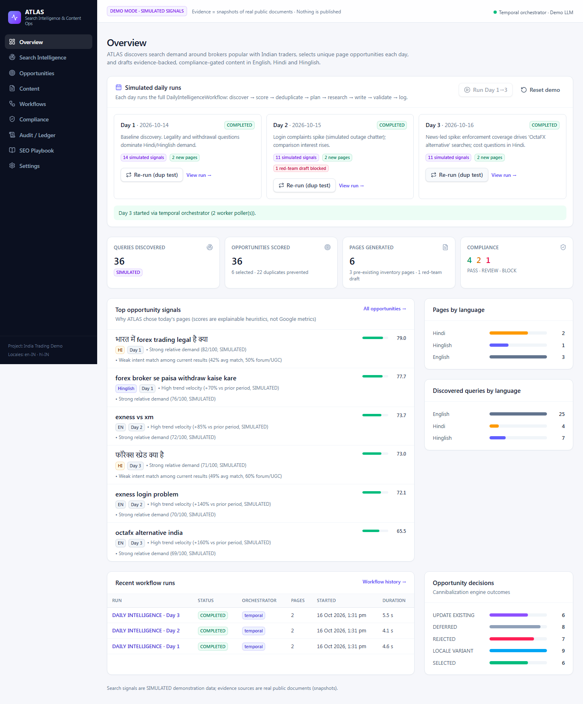
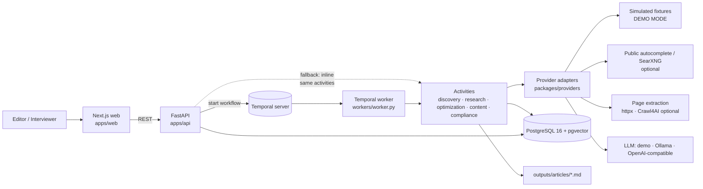

# ATLAS — Autonomous Search Intelligence & Content Operations

> Technical assessment for an **AI Automation Engineer** role. Repository: `seo-intelligence-engine`.
> **Demonstration only** — nothing is published to a real trading website. Search signals are **SIMULATED**
> and labelled as such everywhere; evidence comes from **real public documents** (regulators, government, media).

ATLAS is a lightweight, AI-native SEO intelligence platform. Every day it:

1. **Finds targets** — expands brokers/topics popular with Indian traders into English, Hindi and Hinglish queries
   (review, alternative, X vs Y, deposit, withdrawal, app, bonus, login, fees, spreads, regulation, account
   problems, trading issues, leverage, breaking news) and observes demand/trend signals.
2. **Picks today's pages** — explainable scoring + a multi-signal **cannibalization engine** backed by a
   PostgreSQL `UNIQUE` intent reservation, so the same intent can never be scheduled twice.
3. **Writes the pages** — research *before* drafting (evidence bundle), structured LLM output validated with
   Pydantic, Markdown with frontmatter, FAQ, tables, citations, internal links, schema and hreflang.
4. **Checks quality & compliance** — 19 deterministic rules (authoritative) → `PASS / REVIEW / BLOCK`, plus a
   publication-eligibility gate that keeps **promotional** content `BLOCKED_PENDING_AUTHORIZATION` while the
   target platform's authorization to solicit Indian residents is unverified.
5. **Logs everything** — an append-only ledger ("running sheet") with CSV export, audit events and workflow
   history, all in PostgreSQL.



---

## Contents
1. [Problem statement](#1-problem-statement) · 2. [Requirements mapping](#2-client-requirements-mapping) ·
3. [Architecture](#3-architecture) · 4. [Technology choices](#4-technology-choices) · 5. [Setup](#5-setup) ·
6. [Configuration](#6-environment-configuration) · 7. [Running locally](#7-running-locally) ·
8. [Day 1–3 demo](#8-running-the-day-13-demo) · 9. [Tests](#9-tests) · 10. [Walkthrough](#10-demo-walkthrough) ·
11. [Compliance architecture](#11-compliance-architecture) · 12. [Search-data limitations](#12-search-data-limitations) ·
13. [Production scaling path](#13-production-scaling-path) · 14. [Known limitations](#14-known-limitations) ·
15. [Future improvements](#15-future-improvements)

Further docs: [ARCHITECTURE](docs/ARCHITECTURE.md) · [DEMO_WALKTHROUGH](docs/DEMO_WALKTHROUGH.md) ·
[COMPLIANCE](docs/COMPLIANCE.md) · [SEO_STRATEGY](docs/SEO_STRATEGY.md)

---

## 1. Problem statement

An online forex/CFD platform targets users in India. Established brokers (Exness, XM, OctaFX, …) attract heavy
search interest from Indian traders in three languages. The client wants an AI workflow that runs **every day**,
identifies search opportunities around those brokers, and produces **high-quality, unique, compliant** pages —
without ever creating duplicate pages that compete for the same intent, and without making unsupported or
misleading financial claims. The regulatory context matters: RBI permits residents to trade forex only with
authorised entities on authorised platforms or recognised exchanges, so the system must not assume the target
platform may solicit Indian residents.

## 2. Client requirements mapping

| Requirement | Where it lives | How to see it |
|---|---|---|
| **R1 Find targets** (themes, EN/HI/Hinglish, trending) | `packages/domain/discovery.py`, `language.py`, `workers/discovery` | *Search Intelligence* page; 353 seed queries/day, news/trend providers, `NEW TODAY` freshness |
| **R2 Pick today's pages** (demand, trend, intent, SERP weakness, freshness, relevance, inventory, duplicates, cannibalization) | `packages/domain/scoring.py`, `serp.py`, `cannibalization.py`, `workers/optimization` | *Opportunities* page — score waterfall, "Why this topic?", cannibalization checks |
| Never schedule duplicate intents | `intent_reservations` `UNIQUE(project_id, intent_key)` + 6 independent checks | Day 3 `xm vs exness` → `UPDATE_EXISTING`; forced re-run of a day creates 0 pages |
| Explainable, honest scores | every `ScoreComponent` has value, weight, contribution, provenance, explanation | Badges `SIMULATED / PROXY / REAL_PUBLIC` on every component |
| **R3 Write pages** (title, slug, meta, H2/H3, tables, FAQ, internal links, sources, CTA policy, language/locale, intent, schema, metadata) | `packages/domain/briefs.py`, `renderer.py`, `seo.py`, `workers/content`, `packages/providers/llm.py` | *Content* → article tabs: Preview, SEO & schema, Markdown; files in `outputs/articles/day-N/*.md` |
| **R4 Quality & compliance** (risk warning, unsupported/misleading claims, fake reviews, thin/duplicate, fabricated numbers, logos, guaranteed profit, promo tone, missing citations, cannibalization, repetitive AI text) | `packages/domain/compliance.py` (19 rules), `workers/compliance` | *Compliance* page: decisions, rule catalog, live sandbox; red-team draft is BLOCKED by 9+ rules |
| Educational vs promotional, authorization unknown → REVIEW/BLOCKED | `ContentClass`, `PublicationEligibility`, CMP-011/CMP-019 | *Settings* → India authorization gate |
| **R5 Log everything** (date, run, article, keyword, language, intent, score, slug, statuses, evidence, version, timestamps) | `content_ledger`, `audit_events`, `workflow_runs/steps` | *Audit / Ledger* page + **Download CSV** |
| Day 1/2/3 ≥ 2 unique pages each | `data/fixtures/days.yaml`, `workflows/` | Overview → Run Day 1 → 2 → 3 (6 pages, 0 overlap) |
| Internal links to earlier content | `packages/domain/linking.py`, renderer placeholders | Content → link graph; article → *Internal links* tab |
| Evidence/source tracking | `evidence_sources`, `evidence_claims`, `data/fixtures/evidence.yaml` | Article → *Evidence & sources* (claims + verification status + gaps) |
| Schema, en-IN/hi-IN, mobile/CWV, backlinks | `packages/domain/seo.py`, *SEO Playbook* page, `docs/SEO_STRATEGY.md` | Article → *SEO & schema* tab |
| Workflow history / audit logs | Temporal + `workflow_runs`/`workflow_steps`/`audit_events` | *Workflows* page, Temporal UI |

## 3. Architecture

A **modular monolith + independent worker processes** — not a microservice sprawl.



Flow contract (explicit in `packages/contracts/flow.py`):

```
SearchObservation → KeywordCandidate → Opportunity → ContentPlan → ContentBrief
  → EvidenceBundle → ArticleDraft → ComplianceReport → PublicationRecord
```

Details: [docs/ARCHITECTURE.md](docs/ARCHITECTURE.md).

## 4. Technology choices

| Layer | Choice | Why |
|---|---|---|
| Frontend | Next.js 15 (App Router), React 19, TypeScript, Tailwind v4, TanStack Query, react-markdown | Polished B2B UI; query polling for live run status |
| API | FastAPI + Pydantic v2 + SQLAlchemy 2 | Typed contracts end-to-end, OpenAPI docs at `/docs` |
| Orchestration | **Temporal** (dev server) + inline fallback | Durable, retryable workflows; fallback keeps the demo alive if Temporal is down |
| Database | **PostgreSQL 16 + pgvector** | System of record; DB constraints enforce uniqueness; HNSW cosine indexes |
| Embeddings | Concept-hash embedder (256-d, multilingual concept lexicon) | Deterministic, instant, cross-language (EN/HI/Hinglish map to shared concepts); swappable |
| LLM | Demo provider (deterministic) · Ollama · any OpenAI-compatible API | **Zero paid APIs required**; structured JSON validated + retried |
| Research | httpx extractor with SSRF guard + robots.txt; Crawl4AI optional extra | Safe, light default; heavy browser crawling only when needed |
| Search discovery | Simulated providers (demo) · public autocomplete · SearXNG adapter | Adapters, never hard-coupled to one source |
| Tests | pytest (102), Playwright (9 E2E) | Unit, contract, integration (real Postgres), E2E through the real UI |
| Runtime | `scripts/atlas.py` (no Docker) · `infra/docker-compose.yml` | Works on a locked-down laptop *and* in containers |

**Intentional deviations** (see §14): Redis and MinIO omitted (no meaningful role in the demo — Postgres +
filesystem cover cache/artefacts); SearXNG/Crawl4AI are optional adapters rather than mandatory services.

## 5. Setup

Prerequisites: **Python 3.12**, **Node 20+**, Git. Docker is *optional*.

```bash
git clone https://github.com/NamanChordia07/seo-intelligence-engine.git
cd seo-intelligence-engine
pip install uv                       # or: pipx install uv
uv sync                              # Python deps (incl. bundled Postgres+pgvector via `pgserver` dev dep)
cd apps/web && npx pnpm@9 install && cd ../..
cp .env.example .env                 # optional - every value has a safe default
```

## 6. Environment configuration

All configuration is via environment variables (`ATLAS_*`, see [.env.example](.env.example)); no secrets in code.

| Variable | Default | Meaning |
|---|---|---|
| `ATLAS_DATABASE_URL` | `postgresql+psycopg://atlas@127.0.0.1:5433/atlas` | Postgres with pgvector |
| `ATLAS_ORCHESTRATOR` | `auto` | `temporal` · `inline` · `auto` (Temporal if a worker is polling, else inline) |
| `ATLAS_PROVIDER_MODE` | `demo` | `demo` (SIMULATED fixtures) · `hybrid` · `live` |
| `ATLAS_LLM_PROVIDER` | `demo` | `demo` · `ollama` · `openai` (OpenAI-compatible; optional) |
| `ATLAS_LLM_BASE_URL` / `ATLAS_LLM_MODEL` / `ATLAS_LLM_API_KEY` | Ollama `llama3.2:3b` | Only used when provider ≠ demo |
| `ATLAS_LLM_ADVISORY_REVIEW` | `false` | Add LLM advisory notes to compliance (never authoritative) |
| `ATLAS_LIVE_RESEARCH` | `false` | Re-fetch evidence URLs live (robots.txt + SSRF guard) |
| `ATLAS_SEARXNG_URL` | — | Optional SearXNG for live SERP observations |
| `NEXT_PUBLIC_API_URL` | `http://127.0.0.1:8000` | Web → API |

## 7. Running locally

**One command (no Docker, no admin rights):**

```bash
python scripts/atlas.py up       # Postgres+pgvector :5433, Temporal :7233/:8233, migrations, API :8000, worker, web :3000
python scripts/atlas.py status
python scripts/atlas.py down
```

| Service | URL |
|---|---|
| Web app | http://127.0.0.1:3000 |
| API | http://127.0.0.1:8000 · health `GET /health` |
| API docs (OpenAPI) | http://127.0.0.1:8000/docs |
| Temporal UI | http://127.0.0.1:8233 |

Manual equivalent: `python scripts/devstack.py up` → `uv run alembic upgrade head` →
`uv run uvicorn apps.api.main:app --port 8000` → `uv run python -m workers.worker` →
`cd apps/web && npx next build && npx next start -p 3000`.

Docker alternative: `docker compose -f infra/docker-compose.yml up --build` (authored, not executed on the build machine — see §14).

## 8. Running the Day 1–3 demo

**UI:** Overview → **Reset demo** → **Run Day 1** → **Run Day 2** → **Run Day 3** (or **Run Day 1→3**).
**CLI:** `python scripts/atlas.py demo` · **API:** `POST /api/v1/demo/run-day/{1|2|3}` (`?wait=true` to block).

Result (deterministic):

| Day | New pages | Language | Notable decisions |
|---|---|---|---|
| 1 · 2026-10-14 | *भारत में फॉरेक्स ट्रेडिंग लीगल है क्या?* (regulation guide) · *Forex Broker se Paisa Withdraw Kaise Kare* (troubleshooting) | HI · Hinglish | EN/Hinglish legality queries → `LOCALE_VARIANT`; `is exness legal in india` → overlaps today's page; `forex trading kya hai` → existing inventory |
| 2 · 2026-10-15 | *Exness vs XM: Fact-Checked Comparison Framework* · *Exness Login Problems* | EN · EN | Hindi legality duplicate → `UPDATE_EXISTING`; `exness withdrawal time` → update the Day 1 withdrawal guide; **red-team draft BLOCKED** |
| 3 · 2026-10-16 | *फॉरेक्स स्प्रेड और फीस क्या हैं?* (costs explainer) · *OctaFX Alternatives in India After the ED Action* (news-led) | HI · EN | `xm vs exness` / `exness vs xm which is better` → `UPDATE_EXISTING`; `exness spread` → overlaps today's costs page; leverage → existing inventory |

Compliance: **4 PASS · 2 REVIEW** (named-third-party comparison/news need legal sign-off; comparison relies on
CONFLICTING licence data) **· 1 BLOCK** (red-team). Sample outputs: [`data/demo/sample-output/`](data/demo/sample-output).

## 9. Tests

```bash
uv run pytest -q                              # 102 tests: unit, contract, integration (real Postgres atlas_test DB)
uv run ruff check .
cd apps/web && npx tsc --noEmit && npx next build
cd apps/web && npx playwright test            # 9 E2E tests against the running stack (python scripts/atlas.py up)
```

Covered intentional failures: duplicate keyword, semantic cannibalization, duplicate slug (engine + DB
constraint), reservation `UNIQUE` violation, unsupported claim, guaranteed-profit (EN/HI/Hinglish), missing risk
warning, missing evidence, fabricated citation, fake reviews, logos, solicitation CTA, promo authorization gate,
thin/duplicate/repetitive text, failed crawler, SSRF attempts, malformed LLM output (retry + feedback),
LLM endpoint down, autocomplete/SearXNG unavailable, forced re-run creating zero duplicates.

## 10. Demo walkthrough

A click-by-click interview script (5–10 minutes) is in **[docs/DEMO_WALKTHROUGH.md](docs/DEMO_WALKTHROUGH.md)**.

## 11. Compliance architecture

Deterministic rules are authoritative; the LLM may only *add* advisory notes. Aggregation: any BLOCK → BLOCK,
else any REVIEW → REVIEW, else PASS. Publication eligibility is separate and depends on content class and the
project's **India authorization status** (default `UNKNOWN`). BLOCK can never be human-approved; REVIEW can be
approved by a named reviewer (audited, ledgered). Full rule list: [docs/COMPLIANCE.md](docs/COMPLIANCE.md).

## 12. Search-data limitations

* No paid SEO API is used. **No search volumes are claimed.** `demand_proxy` is a relative 0–100 index —
  SIMULATED in demo mode; in live mode, public autocomplete gives *presence* only (`REAL_PUBLIC`, no volume).
* SERP weakness, competition and authority are **ATLAS heuristics**, explicitly not Google/Ahrefs/Semrush
  metrics. Simulated SERPs use the reserved `.example` TLD so they can never be mistaken for real results.
* Evidence entries are real public documents captured as `FIXTURE_SNAPSHOT` on 2026-10-16; they must be
  re-verified live before any real publication (`ATLAS_LIVE_RESEARCH=true` records live HTTP status).
* Ranking is an optimisation objective (intent match, evidence, links, UX), **never a guarantee**.

## 13. Production scaling path

* **Workers**: stateless; scale by process count and split task queues per domain (discovery / research /
  content / compliance) for independent concurrency and rate limits.
* **Idempotency**: every activity checks for its own outputs per run, so Temporal retries/replays never duplicate
  rows; the intent reservation and slug constraints are the final guard across concurrent runs.
* **Multi-tenancy**: `tenants → projects → *` with `project_id` on every table; add row-level security and
  per-tenant API keys/SSO.
* **Data sources**: plug real providers into the adapters (Search Console API for first-party impressions,
  licensed keyword data, SearXNG pool, Crawl4AI fleet) — scoring/provenance code stays unchanged.
* **Embeddings**: swap the concept-hash embedder for a multilingual sentence model (same `Embedder` protocol;
  migrate the `vector(256)` columns).
* **Publishing**: a `PublicationRecord` sink to a headless CMS behind the eligibility gate, with sitemap pings.
* **Observability**: JSON logs today; add OpenTelemetry traces (Temporal interceptors) + metrics.

## 14. Known limitations

* Demo drafts come from a **curated deterministic content library** (the "demo LLM provider") so the
  walkthrough is reproducible offline; the Ollama/OpenAI-compatible path is implemented, validated and tested
  with mocks, and was exercised against local `llama3.2:3b` (see final report), but small local models produce
  weaker Hindi.
* Intents without a curated draft fall back to a conservative *editor template* that compliance routes to REVIEW.
* Docker Compose/Dockerfiles were written but **not executed** (Docker isn't installed on the build machine);
  the verified path is `scripts/atlas.py` (bundled Postgres via `pgserver` + Temporal CLI dev server).
* Redis, MinIO and OpenTelemetry are not included (no meaningful role at demo scale).
* The concept lexicon covers the demo's brokers/themes; new markets need lexicon entries (or a neural embedder).
* Compliance regexes are deliberately conservative heuristics — they reduce, not eliminate, legal review.
* No authentication (local demo); API is CORS-restricted to the web origin.

## 15. Future improvements

Search Console integration for real impressions/CTR · refresh workflow that applies `UPDATE_EXISTING`
recommendations as new article versions · hreflang pairing job for `LOCALE_VARIANT` queues · editor UI for
inline edits + diff between versions · LLM-assisted claim extraction mapped to evidence (still rule-gated) ·
regulator-list change monitor (RBI Alert List diffing) · role-based approvals and SSO.

---

*Built as a technical demonstration. Broker names are used only as search-demand entities; no broker property is
asserted without a cited source, and nothing here is investment advice.*
