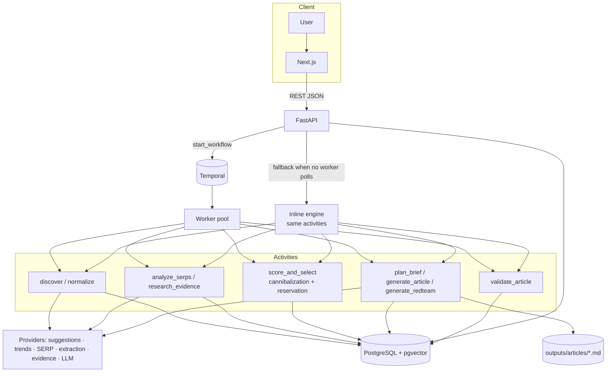
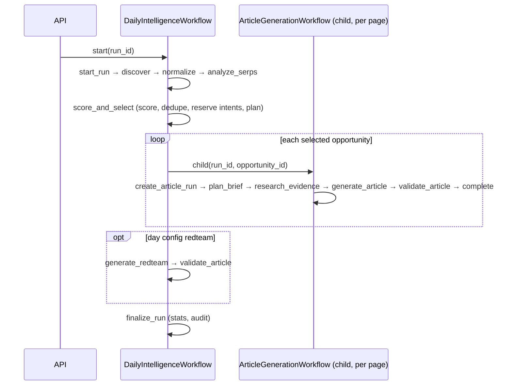

# ATLAS Architecture

## 1. Shape: modular monolith + workers

| Unit | Process | Code |
|---|---|---|
| web | Next.js server | `apps/web` |
| api | FastAPI (uvicorn) | `apps/api` |
| temporal worker(s) | `python -m workers.worker` | `workers/`, `workflows/` |
| PostgreSQL 16 + pgvector | system of record | `packages/persistence`, `infra/migrations` |
| Temporal server | durable workflow state | dev server (`temporal server start-dev`) |

Bounded domain modules live in `packages/` and are pure Python (no I/O) wherever possible:

```
packages/
  contracts/   enums + the typed flow contract (Pydantic)
  domain/      language, discovery, serp, scoring, cannibalization, briefs, linking, renderer, seo, compliance, embedding
  providers/   adapter interfaces + simulated / live / LLM implementations
  persistence/ SQLAlchemy models, sessions, repositories, seed
  telemetry/   structured JSON logging
workers/       Temporal activities grouped by domain (discovery, research, optimization, content, compliance)
workflows/     Temporal workflows + inline fallback dispatcher (engine.py)
```



## 2. Workflows



`DemoSimulationWorkflow` runs Day 1..N sequentially as child `DailyIntelligenceWorkflow`s. Workflows reference
activities **by name** so the workflow sandbox never imports DB/HTTP code.

**Retry behaviour**: activities use `RetryPolicy(initial 2s, backoff ×2, max 3 attempts)`; LLM/research
activities have a 10-minute start-to-close timeout. A failed child article workflow is recorded on its child run
(`FAILED`) and the day finishes as `PARTIAL` — one bad page never sinks the day.

**Orchestrator selection** (`workflows/engine.py`): `auto` uses Temporal only if the server is reachable **and**
`DescribeTaskQueue` shows at least one worker poller; otherwise the identical activity sequence runs inline in a
background thread. The choice and reason are stored on the run (`orchestrator`, `stats.orchestrator_reason`).

## 3. Idempotency

Every activity can be replayed safely:

| Activity | Idempotency key |
|---|---|
| discover | observations exist for `run_id` → skip |
| normalize | upsert `keyword_candidates` on `(project_id, normalized_query, language)` |
| analyze_serps | one snapshot per `(run_id, candidate_id)` |
| score_and_select | opportunities exist for `run_id` → return stored selection; `UNIQUE(run_id, candidate_id)` |
| plan_brief | `UNIQUE(opportunity_id)` on briefs |
| generate_article | `opportunity.article_id` set → skip; `UNIQUE(project_id, slug)` |
| validate_article | decision exists for `(article_id, version)` → skip |
| steps | `UNIQUE(run_id, name)`; retries increment `attempts` |

## 4. Database constraints that enforce business rules

* `uq_reservation_project_intent` — **an intent can be reserved once per project**. Reservation happens in a
  SAVEPOINT; an `IntegrityError` turns the opportunity into `REJECTED` with the reason recorded.
* `uq_article_project_slug`, `uq_article_version`, `uq_internal_link_pair`, `uq_candidate_project_query_lang`.
* `uq_active_daily_run` (partial unique index) — at most one `QUEUED/RUNNING` daily run per simulated day.
* HNSW `vector_cosine_ops` indexes on article and candidate embeddings (pgvector).

## 5. Provider abstraction

`packages/providers/base.py` defines `SearchSuggestionProvider`, `TrendProvider`, `SerpProvider`,
`PageExtractionProvider`, `EvidenceProvider`, `LLMProvider`. Implementations:

| Interface | Demo (default) | Live / optional |
|---|---|---|
| Suggestions | `SimulatedSuggestionProvider` (fixture per day) | `GoogleAutocompleteProvider` (presence only, request budget) |
| Trends/news | `SimulatedTrendProvider` | — (extension point) |
| SERP | `FixtureSerpProvider` (`.example` domains) | `SearxngSerpProvider` |
| Extraction | — | `SafeHttpExtractor` (SSRF guard, robots.txt, 2 MB cap, 8 s timeout), `Crawl4AIExtractor` |
| Evidence | `FixtureEvidenceProvider` (real public docs, snapshots) | live re-verification via extractor |
| LLM | `DemoLLMProvider` (curated library) | `OpenAICompatibleLLMProvider` (Ollama / hosted) |

All live providers raise `ProviderUnavailable`; callers degrade gracefully (recorded in step details).
LLM output is parsed (fenced JSON tolerated), validated against `LLMArticlePayload`, and retried with the
validation error fed back; after `max_retries` the content worker falls back to the demo provider and writes an
`LLM_FALLBACK` audit event.

## 6. Multi-tenancy

`tenants → projects`; every business table carries `project_id` (indexed, FK, cascade). The demo seeds one
tenant/project. Production additions: row-level security policies keyed on `project_id`, per-tenant API keys,
per-tenant provider credentials in a secrets manager, and task-queue partitioning per tenant for fairness.

## 7. Worker scaling & future distributed deployment

* Workers are stateless; run N processes (`docker compose up --scale worker=N`). Temporal distributes tasks.
* Split task queues by domain (`atlas-discovery`, `atlas-content`, …) to apply different concurrency and rate
  limits (e.g. LLM-bound content workers on GPU hosts, I/O-bound research workers elsewhere).
* Postgres: managed instance with PITR; pgvector HNSW indexes; read replica for the dashboard.
* Artefacts: `outputs/articles` → object storage (S3/MinIO) when multiple hosts write.
* Temporal: Temporal Cloud or self-hosted cluster with Postgres/Cassandra persistence.

## 8. Security controls

Secrets only via env vars (`.env` git-ignored); ORM-only SQL; Pydantic validation on all inputs (regex-checked
reviewer names, enum-checked settings); CORS restricted to the web origin and methods; SSRF guard and robots.txt
for crawling; no shell execution exposed by the API; security headers on the web app; dependency lockfiles
(`uv.lock`, `pnpm-lock.yaml`).
